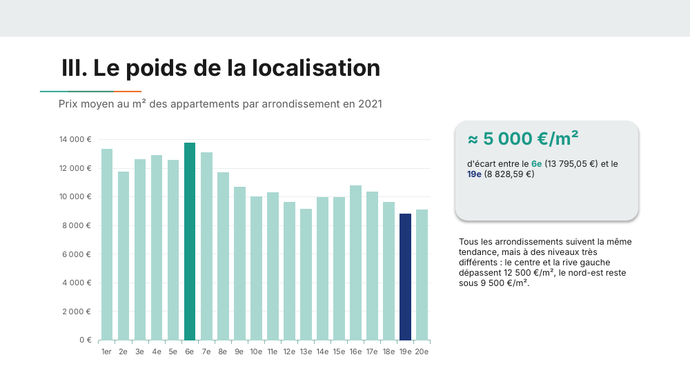
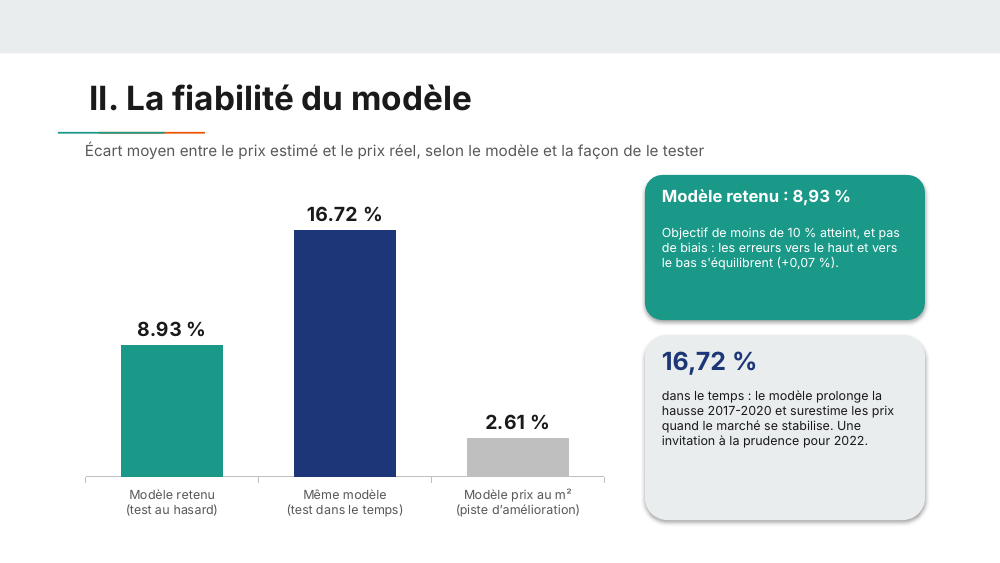
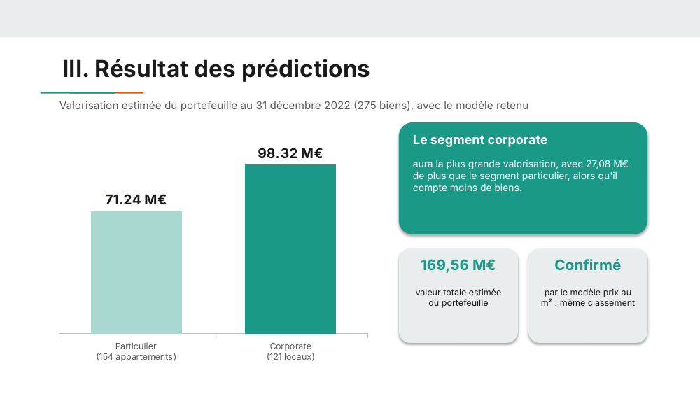
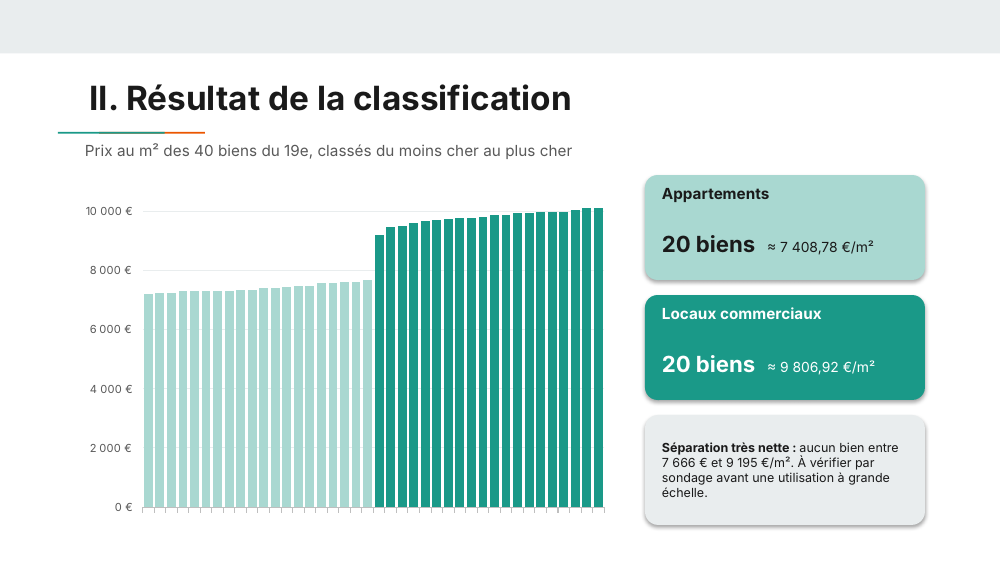

# 🏠 Analyse et prédiction des prix de l'immobilier à Paris avec Python

*Projet 8 de la formation **Business Intelligence Analyst** – OpenClassrooms*

## 🎯 Contexte et objectif

La société **Les Plus Beaux Logis de Paris** possède un portefeuille de **275 biens** répartis en deux segments : les appartements (segment particulier) et les locaux commerciaux (segment corporate).

Ma mission :
1. **Analyser le marché immobilier parisien** de 2017 à 2021 pour comprendre ce qui fait le prix d'un bien ;
2. **Entraîner un modèle de prédiction** du prix, avec une erreur moyenne inférieure à 10 % ;
3. **Estimer la valeur du portefeuille au 31 décembre 2022** et identifier le segment qui aura la plus grande valorisation ;
4. **Classer automatiquement** des biens dont le type est inconnu (appartement ou local commercial).

## 🗂️ Données

- **Historique des ventes** : 26 196 transactions à Paris, de janvier 2017 à décembre 2021 (93 % d'appartements, 7 % de locaux commerciaux)
- **Portefeuille de la société** : 275 biens à valoriser
- **Jeu de test** : 40 ventes du 19e arrondissement, sans type connu
- **Qualité** : aucune valeur manquante, 16 doublons (0,06 %) conservés après analyse

## 🛠️ Outils et compétences

- **Python** dans un **notebook Jupyter** : pandas, NumPy, Matplotlib
- **Statistiques** : corrélation de Pearson et p-value
- **Machine learning (scikit-learn)** : régression linéaire, encodage one-hot, séparation apprentissage / test, mesure de l'erreur (MAPE), **KMeans** pour la classification
- **Restitution** : présentation des résultats à la direction, sans jargon technique

## 🔎 Démarche

1. **Analyse du marché** : évolution du prix au m², écarts entre arrondissements, influence de la surface, de la date et du type de bien
2. **Modélisation** : régression linéaire entraînée sur 2/3 des ventes et testée sur le 1/3 restant
3. **Analyse critique** : test complémentaire dans l'ordre chronologique (apprentissage sur 2017-2020, test sur 2020-2021) pour vérifier la robustesse du modèle
4. **Valorisation du portefeuille** au 31/12/2022
5. **Classification** des 40 biens inconnus avec l'algorithme KMeans

## 📊 Aperçu

**Le poids de la localisation : près de 5 000 €/m² d'écart entre arrondissements**

**La fiabilité du modèle**

**La valorisation du portefeuille au 31 décembre 2022**

**La classification des biens avec KMeans**

## 💡 Principaux résultats

- **Le marché** : +10,14 % de hausse du prix au m² des appartements entre 2017 et 2021, avec un léger repli en 2021. Le prix dépend de **la surface** (corrélation de 0,98), **la date**, **l'arrondissement** et **le type de bien**.
- **Le modèle** : **8,93 %** d'erreur moyenne, sous l'objectif de 10 %, et sans biais (+0,07 %). En lui faisant prédire le **prix au m²** plutôt que le prix total, l'erreur descend à **2,61 %**.
- **Le portefeuille** : le **segment corporate** aura la plus grande valorisation, avec **98,32 M€** contre 71,24 M€ pour le particulier (169,56 M€ au total), alors qu'il compte moins de biens.
- **La classification** : les 40 biens se répartissent en **20 appartements et 20 locaux commerciaux**, avec une séparation très nette. Testée sur 241 ventes dont le type était connu, la méthode les a toutes bien classées.

## ⚠️ Limites et prochaines pistes

- Testée dans l'ordre du temps, la régression linéaire fait **16,72 %** d'erreur : elle prolonge la hausse passée et **surestime** les prix quand le marché se stabilise. Les montants pour 2022 sont donc à prendre comme des **ordres de grandeur**, probablement un peu optimistes.
- Des informations importantes manquent : état du bien, étage, ascenseur, extérieur…
- **Pistes** : ajouter ces variables, tester des modèles non linéaires (forêts aléatoires, gradient boosting) et actualiser le modèle avec des données 2022.

## 📁 Fichiers du projet

| Fichier | Contenu |
|---|---|
| [presentation.pdf](presentation.pdf) | La présentation des résultats à la direction |
| [notebook_analyse_immobilier.ipynb](notebook_analyse_immobilier.ipynb) | Le notebook Python complet, **lisible directement dans GitHub** |

---
👩‍💼 **Manal Salhi** – Business Analyst / Data Analyst · [LinkedIn](https://www.linkedin.com/in/manal-salhi-030a692b5/)
